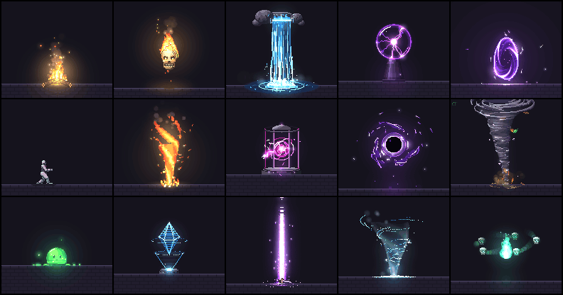
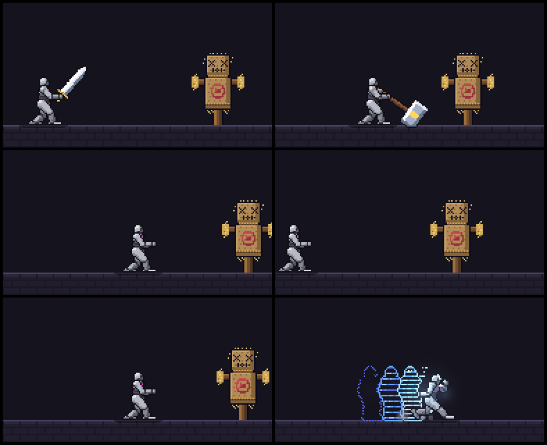

<p align="center">
  
</p>

# pixelfx.

[English](README.md) · **Tiếng Việt**

**<!-- count -->244<!-- /count --> hiệu ứng và hoạt ảnh pixel art, mỗi hiệu ứng là một đoạn code nhỏ.** Lửa,
vụ nổ, phép thuật, thời tiết, UI, vật phẩm, sinh vật và nhiều hơn nữa. Chạy thử trực tiếp, đổi màu và lật chúng,
thả vào một game trên trình duyệt, hoặc xuất sprite sheet cho bất kỳ engine nào. Kèm một skill cho Claude Code
để tạo hiệu ứng mới theo cách một họa sĩ pixel khó tính vẫn làm: phác thảo, dựng hình, ngắm, tinh chỉnh.

Mọi hiệu ứng có nhân vật đều được **diễn xuất**: anh ta lấy đà, tung đòn, khựng lại khi chạm đích và hồi phục,
còn mục tiêu thì lãnh đòn. Mười hai chiêu thức trọn vẹn xâu chuỗi các hiệu ứng thành đòn tấn công từ lúc lấy
đà đến khi hồi phục.

Nó cũng là một block trên Patch: [chơi pixelfx trên Patch](https://patch.gg/patch/pixel-effects), chọn một
hiệu ứng và một bảng màu, rồi bắt đầu một game trình duyệt từ đó.

**[mở thư viện](https://patch-gg.github.io/pixelfx/)** · [danh mục](docs/CATALOG.md) · [diễn xuất](#diễn-xuất) ·
[skill](#skill) · [tự làm của riêng bạn](#tự-làm-hiệu-ứng-của-riêng-bạn) · [đăng lên patch](#đăng-lên-patch) ·
[cách nó hoạt động](#cách-nó-hoạt-động)

Phương pháp là của [Hugo Duprez](https://x.com/HugoDuprez), từ bài [How to make (good) pixel art effects with
Claude](https://www.spritefusion.com/blog/how-to-make-good-pixel-art-effects-with-claude): code là đất sét,
hãy tin vào mắt mình, nuôi dưỡng bằng tư liệu tham khảo. Các [hiệu ứng mã nguồn
mở](https://www.spritefusion.com/pixel-art-vfx) của anh tại Sprite Fusion đặt ra chuẩn mực, và
`src/core/sim.js` cùng các hiệu ứng có ghi như vậy ở đầu file đã phỏng theo code của anh. Repo này là cách
chúng tôi triển khai ý tưởng ở quy mô thư viện, kèm một skill để tiếp tục phát triển.

## có gì trong này.

<!-- catalog -->
| nhóm | số lượng | một vài ví dụ |
|---|---|---|
| **chiêu thức** | 12 | arrow shot, dash strike, earth stomp, fireball throw, ground pound, holy smite… |
| **lửa** | 12 | brazier, campfire, candle, fire breath, fire ring, fire tornado… |
| **vụ nổ** | 12 | barrel explosion, big explosion, cartoon pow, dirt explosion, firework burst, firework rocket… |
| **nước** | 12 | bubbles, drip, fountain, geyser, rain splash, ripples… |
| **băng** | 10 | blizzard vortex, freeze, frost breath, frost nova, ice crystal, ice lance… |
| **sét** | 11 | ball lightning, chain lightning, charge up, electrified, lightning strike, plasma ball… |
| **khoa học viễn tưởng** | 12 | emp blast, energy core, force field, glitch, hologram, jetpack… |
| **cận chiến** | 12 | claw swipe, dagger flurry, double slash, hammer smash, heavy cleave, scythe reap… |
| **va chạm** | 11 | blunt hit, bullet impact, critical hit, ground slam, heavy landing, hit flash… |
| **đạn bay** | 13 | arrow, bullet tracer, cannon shot, energy disc, signal flare, homing missile… |
| **xuất hiện & chết** | 10 | coin drop, disintegrate, dissolve burn, egg hatch, poof, respawn beam… |
| **bí truyền** | 12 | arcane beam, arcane missiles, arcane orb, blink in, blink out, magic circle cast… |
| **thần thánh** | 10 | blessing, divine shield, feather burst, halo, heal, healing ring… |
| **bóng tối** | 12 | black hole, curse, dark explosion, eclipse, grasping hands, hex sigil… |
| **trạng thái** | 13 | bleeding, burning, charmed, confused, cursed, frozen… |
| **thiên nhiên** | 13 | acid splash, boulder, earth spike, healing bloom, leaf storm, poison cloud… |
| **thời tiết** | 12 | aurora, blizzard, cherry blossoms, clouds, falling leaves, fireflies… |
| **ui** | 12 | achievement, coin collect, combo counter, confetti, countdown, crit number… |
| **vật phẩm nhặt** | 11 | chest open, coin spin, collect burst, crystal shard, gem spin, heart pickup… |
| **chuyển cảnh** | 10 | blinds, burn away, crt off, diamond wipe, glitch wipe, iris… |
| **sinh vật nhỏ** | 12 | bat, bird, butterfly, eyeball, fish school, flying skull… |
<!-- /catalog -->

Mỗi hiệu ứng là một file trong `src/fx/<category>/<name>.js`. [Danh mục](docs/CATALOG.md) liệt kê tất cả.

## dùng một hiệu ứng.

**Trong game trình duyệt** (canvas, Phaser, PixiJS, Kaplay, three.js), dùng code. Không phụ thuộc thư viện nào.

```js
import { createFrame, clearFrame, createFx, composite } from "pixelfx";
import * as frostNova from "pixelfx/fx/ice/frost-nova";

const frame = createFrame(320, 180);                   // your game's pixel resolution
const img = new ImageData(320, 180);
const fx = createFx(frostNova, { x: 160, y: 140 });   // also: flip, angle, seed, palette, light...

function tick(dt) {
  fx.update(dt);
  clearFrame(frame);
  fx.draw(frame, "back");                              // behind characters
  drawCharacters();
  fx.draw(frame, "front");
  composite(frame, img.data, backgroundColor);         // color, then light added on top
  ctx.putImageData(img, 0, 0);                         // scale up with image-rendering: pixelated
}
```

Cài từ GitHub bằng `npm i github:patch-gg/pixelfx`, hoặc copy `src/core` và các hiệu ứng bạn muốn.

**Trong bất kỳ engine nào** (Godot, Unity, GameMaker, Defold, LÖVE, Bevy), dùng sprite sheet:

```bash
node tools/render.mjs ice/frost-nova --sheet
```

Lệnh này ghi ra một PNG trong suốt của mọi khung hình xếp theo lưới và một JSON kiểu Aseprite (hình chữ nhật
của khung, thời lượng, và `meta.pixelfx` với fps, vòng lặp, số cột và điểm neo). Bộ nạp atlas của Phaser và
các trình nhập Aseprite cho Godot và Unity đều đọc được. `node tools/sheets.mjs` xuất toàn bộ thư viện vào
`sheets/`.

Mọi hiệu ứng đều nhận một `palette` (một dải màu hex từ tối đến sáng), nên một ngọn lửa có thể cháy màu xanh
dương và một hiệu ứng hồi máu có thể phát sáng hồng mà không cần đụng vào code của nó:

```bash
node tools/render.mjs fire/torch --gif --opts '{"palette": ["#102","#215","#43a","#8cf","#cff","#fff"]}'
```

## diễn xuất.

<p align="center">
  
</p>

Một hiệu ứng đứng một mình trông như một miếng dán. Thứ làm cho đòn đánh có sức nặng là cơ thể xung quanh nó:
cú lấy đà báo hiệu điều sắp đến, khoảnh khắc khựng khi chạm đích, mục tiêu loạng choạng lùi lại, rồi hồi
phục. Vì vậy 61 hiệu ứng có nhân vật, và 12 chiêu thức, đều mô tả cơ thể làm gì và khi nào:

```js
export const act = {
  target: { x: 58 },
  poses: [
    [-0.55, GUARD],            // he starts before the effect does (t = 0 is the effect's first frame)
    [-0.3, WIND_UP],
    [0, CUT, "snap"],          // "snap" holds the last pose and jumps on the key
    [0.06, FOLLOW_THROUGH, "snap"],
    [0.86, GUARD],
  ],
  hits: [{ t: 0.06, stop: 0.14, shake: 0.18, amp: 2, push: 2.8, straw: 18 }],   // freeze for 0.14 s on contact
};
```

**Chạy toàn bộ**, cả nhân vật lẫn mục tiêu, bằng cách thay `createFx` bằng `createAct`:

```js
import { createFrame, clearFrame, createAct, composite } from "pixelfx";
import * as slash from "pixelfx/fx/melee/sword-slash";

const act = createAct(slash, { x: 80, y: 140 });

function tick(dt) {
  act.update(dt);                                  // holds still by itself during a freeze
  clearFrame(frame);
  act.draw(frame);                                 // { body: false } and { target: false } leave them out
  composite(frame, img.data, backgroundColor);
  const [sx, sy] = act.shake;                      // throw the picture this far
  ctx.putImageData(img, sx, sy);
}
```

**Đã có nhân vật của riêng bạn?** Id của hiệu ứng không đổi và sprite sheet vẫn chỉ là hiệu ứng đơn lẻ, nên
các game hiện có vẫn chạy bình thường. (Các hiệu ứng vẽ trên cơ thể dùng hình nộm có sẵn, nên hãy tạo lại
chúng nếu bạn phát hành.) Thời gian chỉ là dữ liệu thuần: đọc `slash.act`, hoặc `meta.pixelfx.act` trong JSON
của sprite sheet (`windup`, `recovery`, `hits` với `t` và `freeze`, `poses`). Bắt đầu hoạt ảnh lấy đà của bạn
trước hiệu ứng chừng đó thời gian, và dừng cập nhật mọi thứ trong `freeze` giây ở mỗi đòn trúng.

Các hiệu ứng vẽ trên cơ thể (băng giá, độc, một đường quét) được viết theo nhân vật đang đứng và đi theo anh
ta đến bất cứ đâu: mỗi pixel của một tư thế đều biết nó xuất phát từ pixel nào của cơ thể đứng. `node tools/act.mjs
<id> --sheet` kết xuất toàn bộ một màn diễn, gồm cả nhân vật, thành một sprite sheet.

Cơ thể cũng là của bạn để dùng: `skeleton(pose)` cho bạn mọi khớp của một tư thế trong 3D để treo đồ của
bạn lên, và `posedParts(pose)` cho bạn từng bộ phận được vẽ riêng.

## skill.

Skill `pixelfx` dạy Claude Code cách tìm, dùng, xuất và tạo hiệu ứng. Cài nó như một plugin:

```
/plugin marketplace add patch-gg/pixelfx
/plugin install pixelfx@pixelfx
```

hoặc copy `skills/pixelfx` vào `~/.claude/skills/`. Rồi yêu cầu điều bạn muốn:

- "Thêm một vụ nổ băng giá vào chiêu cuối của pháp sư của tôi."
- "Làm năm phiên bản hiệu ứng lấp lánh khi nhặt xu và cho tôi xem hai bản đẹp nhất."
- "Xuất các nhóm lửa và vụ nổ thành sprite sheet cho Godot."
- "Hiệu ứng đòn đánh này cảm giác nhẹ hều. Làm cho nó đấm đã hơn."
- "Cho phép thuật này một đoạn lấy đà và làm cho kẻ địch phản ứng lại."

## tự làm hiệu ứng của riêng bạn.

```bash
node tools/new.mjs arcane/my-spell       # a working starting point (add --loop for a loop)
node tools/render.mjs arcane/my-spell    # records/arcane/my-spell/contact.png: look at it
node tools/check.mjs arcane/my-spell     # spills, seams, unseeded randomness, slow frames
```

Rồi cứ thế lặp lại: xem contact sheet, sửa chỗ tệ nhất, kết xuất lại. `--gif` và `--mp4` cho thấy chuyển
động, `--all` cho thấy mọi khung hình. `node tools/act.mjs arcane/my-spell` hiển thị một màn diễn dưới dạng
các bước liên tiếp 12 fps, vì lỗi chuyển động không lộ ra trong ảnh mẫu. [docs/AUTHORING.md](docs/AUTHORING.md)
có bản giao kèo, API vẽ và tiêu chuẩn chất lượng. `node tools/serve.mjs` chạy thư viện cục bộ với các hiệu
ứng của bạn trong đó.

## đăng lên patch.

Đã làm một game trình duyệt bằng những hiệu ứng này? Đưa nó lên [Patch](https://patch.gg), nơi mọi người
chơi và remix các game trình duyệt và bản mod. Cài `pch`, công cụ dòng lệnh của Patch, rồi khởi động lại
coding agent của bạn và nhờ nó đăng game: bản cài đặt trao cho mọi agent trên PC của bạn các công cụ của
Patch. Hoặc tự chạy:

```bash
npm i -g @patchgg/cli      # or: curl -fsSL https://patch.gg/install.sh | sh
pch login
pch init                   # in your game's folder; it says what's next
pch publish
```

Việc đăng tải cần [Patch Desktop](https://docs.patch.gg/get-started) đang mở trên một PC Windows: nó chơi
thử game của bạn một lần để kiểm tra trước khi lên sóng. [Hướng dẫn nhanh](https://docs.patch.gg/quickstart)
có phần còn lại.

## cách nó hoạt động.

- **Hai loại hiệu ứng, không dùng hình ảnh.** Hiệu ứng thuần xuất `draw(p, t, o)`, khung hình tại `t` giây
  chỉ từ `t`, nên các vòng lặp nối nhau không để lại đường nối. Hiệu ứng mô phỏng xuất `create(o)` và bước
  các hạt, mảnh vỡ và ánh sáng thật ở 120 Hz, nên tia lửa nảy và khói cuộn giống nhau ở mọi tốc độ khung hình.
- **Hai bộ đệm.** `color` nhận các pixel: đục, phối màu (dither) hoặc trong mờ thật sự. `light` nhận ánh
  sáng cộng thêm (additive glow), chồng lên trên. Những thứ nóng trông nóng là nhờ bộ đệm ánh sáng.
- **Mọi thứ đều có seed.** Mọi số ngẫu nhiên đều đến từ seed của hiệu ứng, nên khung hình 40 lần nào cũng
  giống hệt nhau.
- **Không gian cục bộ.** Hiệu ứng vẽ quanh gốc tọa độ của chính nó; bộ vẽ sẽ đặt, lật và xoay chúng. Hiệu
  ứng có hướng thì hướng sang phải. Một nhân vật có sẵn 24×38 đại diện cho các hiệu ứng trạng thái, hào quang
  và đòn đánh.
- **Một bộ xương thật, vẽ đến từng pixel.** Hình nộm xám trung tính là có chủ đích, để mắt tập trung vào
  chiêu thức và màu của bất kỳ hiệu ứng nào cũng đọc rõ trên nó. Anh ta là một bộ xương 3D với các xương có
  độ dài cố định, từ xương chậu đến cột sống đến vai, được dựng bằng vài tông màu phẳng với một đường mực
  sạch, theo cách Dead Cells làm sprite của nó. Nhờ vậy anh ta có thể vặn mình, uốn cong và thực sự quay
  vòng, và độ sâu quyết định cái gì ở phía trước. Các tư thế giữ nguyên theo bước 12 fps, như sprite vẽ tay
  vẫn làm, trong khi các hạt chạy ở tốc độ tối đa.
- **Cùng định dạng khung hình với VFX của Sprite Fusion** (`{ w, h, ox, oy, color, light }`), nên cả hai thư
  viện có thể vẽ vào cùng một khung hình.

## giấy phép.

MIT, cho cả code và hiệu ứng. Dùng chúng trong bất cứ thứ gì, kể cả thương mại. Một số phần được phỏng theo
các hiệu ứng MIT của Hugo Duprez và từ mã nguồn MIT của Hollow Crown, và font Patch Pixel trong
`gallery/fonts` là của riêng Patch và không nằm trong phạm vi này: xem [NOTICE.md](NOTICE.md).

Được làm bởi [Patch](https://patch.gg).
